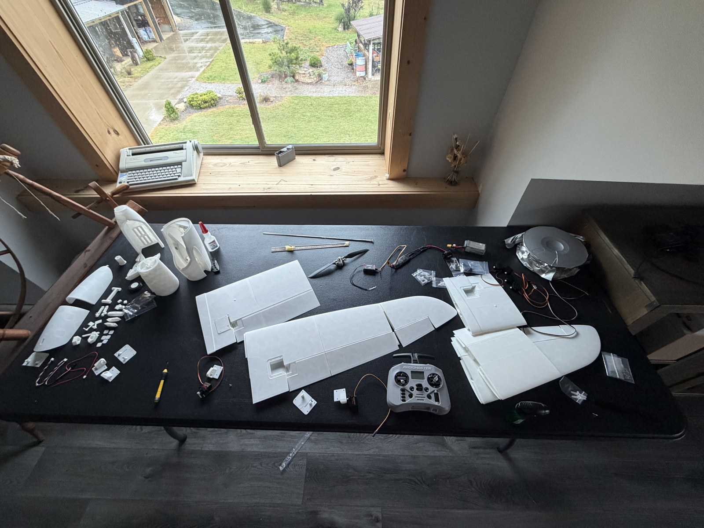

# Build photos and videos

[Project overview](../../README.md) · [Build log](../../docs/build-log.md)

Media for the April 22–May 29, 2026 progress update. The supplied files were captured on May 22, 26, and 27; dates use America/Chicago time.

## Photos

| May 22: Printed components | May 26: Wing assembly |
|---|---|
|  |  |

## Videos

Each link opens a full-duration, compressed MP4 viewing copy. Previews are frames from the recordings. Assembly and bench work are shown; flight testing is still pending.

May 26, 2026

| Preview | Recording | Length |
|---|---|---:|
|  | [Airframe close-up — IMG_1437](IMG_1437.mp4) | 0:05 |
|  | [Airframe and wing overview — IMG_1438](IMG_1438.mp4) | 0:14 |
|  | [Electronics and control hardware — IMG_1439](IMG_1439.mp4) | 0:06 |
|  | [Radio and electronics bench setup — IMG_1441](IMG_1441.mp4) | 2:57 |

May 27, 2026

| Preview | Recording | Length |
|---|---|---:|
|  | [Airframe assembly on the bench — IMG_1449](IMG_1449.mp4) | 1:00 |
|  | [Electronics and printed parts — IMG_1450](IMG_1450.mp4) | 0:49 |
|  | [Workbench overview — IMG_1451](IMG_1451.mp4) | 0:08 |
|  | [Airframe components — IMG_1452](IMG_1452.mp4) | 0:51 |
|  | [Bench work — IMG_1453 13](IMG_1453-13.mp4) | 9:01 |
|  | [Bench work — IMG_1453 12](IMG_1453-12.mp4) | 3:00 |
|  | [Bench work — IMG_1453 11](IMG_1453-11.mp4) | 3:01 |
|  | [Bench work — IMG_1453 10](IMG_1453-10.mp4) | 3:02 |
|  | [Bench work — IMG_1453 9](IMG_1453-9.mp4) | 1:00 |
|  | [Bench work — IMG_1453 8](IMG_1453-8.mp4) | 1:01 |
|  | [Bench work — IMG_1453 7](IMG_1453-7.mp4) | 1:01 |
|  | [Bench work — IMG_1453 6](IMG_1453-6.mp4) | 1:00 |
|  | [Bench work — IMG_1453 5](IMG_1453-5.mp4) | 1:01 |
|  | [Bench work — IMG_1453 4](IMG_1453-4.mp4) | 1:01 |
|  | [Bench work — IMG_1453 3](IMG_1453-3.mp4) | 1:01 |
|  | [Bench work — IMG_1453 2](IMG_1453-2.mp4) | 1:01 |
|  | [Bench work — IMG_1453](IMG_1453.mp4) | 1:01 |

## About the files

The 25 original files are preserved locally. This gallery displays two photo conversions and 21 video viewing copies. Each HEIC/MOV Live Photo pair is represented by its still photo, so those motion companions do not appear as duplicate videos.

The numbered IMG_1453 recordings are distinct files and are kept separately. The [media manifest](manifest.json) records original filenames, sizes, capture times, and SHA-256 fingerprints.

Viewing copies have a maximum dimension of 480 pixels at 15 fps, with audio retained where present. Original capture metadata is removed from the viewing copies.
