# Videos

[Home](../../README.md) · [Build log](../../docs/build-log.md) · [Photos](photos.md) · **Videos** · [Parts & costs](../../docs/parts-and-costs.md) · [Receipts](../orders/README.md)

All 21 video files from the spring build update. Labels describe the subject shown in each preview. Select a thumbnail or its Watch link to open the same clip. Lengths are shown as minutes:seconds. For still images, choose Photos.

[May 26: 4 videos](#may-26-2026) · [May 27: 17 videos](#may-27-2026)

## May 26, 2026

| Clip | Preview — select to open | Watch | Length |
|---|---|---|---:|
| **01 · Airframe close-up** | [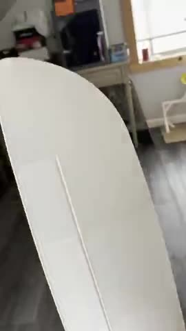](IMG_1437.mp4) | [Watch clip 01](IMG_1437.mp4) | 0:05 |
| **02 · Airframe and wing overview** |  | [Watch clip 02](IMG_1438.mp4) | 0:14 |
| **03 · Electronics and control hardware** | [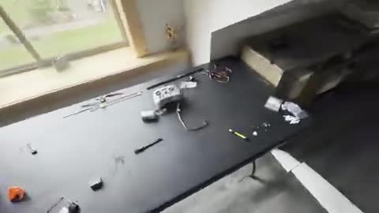](IMG_1439.mp4) | [Watch clip 03](IMG_1439.mp4) | 0:06 |
| **04 · Radio and electronics setup** | [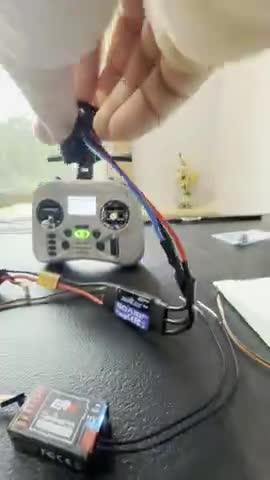](IMG_1441.mp4) | [Watch clip 04](IMG_1441.mp4) | 2:57 |

[Back to video dates](#videos)

## May 27, 2026

| Clip | Preview — select to open | Watch | Length |
|---|---|---|---:|
| **05 · Airframe assembly on the bench** | [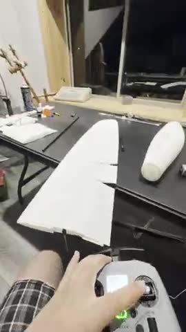](IMG_1449.mp4) | [Watch clip 05](IMG_1449.mp4) | 1:00 |
| **06 · Electronics and printed parts** | [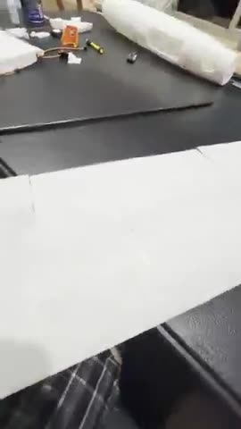](IMG_1450.mp4) | [Watch clip 06](IMG_1450.mp4) | 0:49 |
| **07 · Workbench overview** | [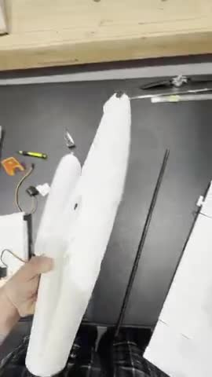](IMG_1451.mp4) | [Watch clip 07](IMG_1451.mp4) | 0:08 |
| **08 · Airframe components** |  | [Watch clip 08](IMG_1452.mp4) | 0:51 |
| **09 · Fuselage and wing sections** |  | [Watch clip 09](IMG_1453-13.mp4) | 9:01 |
| **10 · Fuselage and wing sections** | [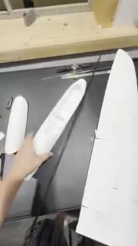](IMG_1453-12.mp4) | [Watch clip 10](IMG_1453-12.mp4) | 3:00 |
| **11 · ER8 receiver close-up** | [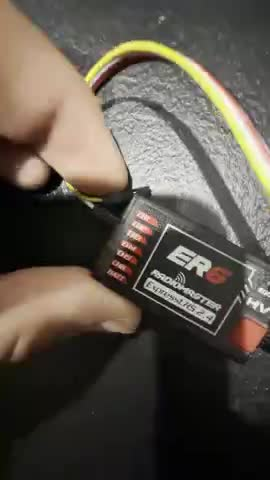](IMG_1453-11.mp4) | [Watch clip 11](IMG_1453-11.mp4) | 3:01 |
| **12 · Wing panel and radio** | [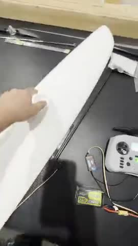](IMG_1453-10.mp4) | [Watch clip 12](IMG_1453-10.mp4) | 3:02 |
| **13 · Fuselage and wing sections** |  | [Watch clip 13](IMG_1453-9.mp4) | 1:00 |
| **14 · Wing section on the bench** | [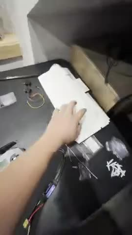](IMG_1453-8.mp4) | [Watch clip 14](IMG_1453-8.mp4) | 1:01 |
| **15 · Reinforcement rod and wing** | [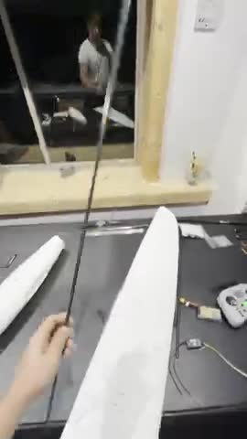](IMG_1453-7.mp4) | [Watch clip 15](IMG_1453-7.mp4) | 1:01 |
| **16 · ER8 receiver close-up** | [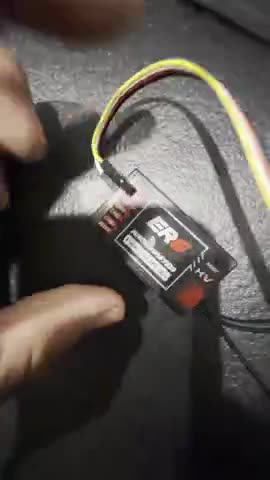](IMG_1453-6.mp4) | [Watch clip 16](IMG_1453-6.mp4) | 1:00 |
| **17 · Radio and electronics** | [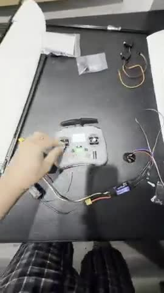](IMG_1453-5.mp4) | [Watch clip 17](IMG_1453-5.mp4) | 1:01 |
| **18 · Motor and wiring** | [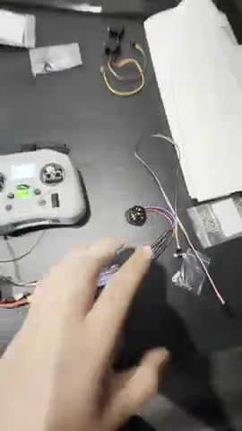](IMG_1453-4.mp4) | [Watch clip 18](IMG_1453-4.mp4) | 1:01 |
| **19 · Wing panel and radio** | [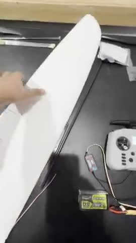](IMG_1453-3.mp4) | [Watch clip 19](IMG_1453-3.mp4) | 1:01 |
| **20 · Wing panel close-up** | [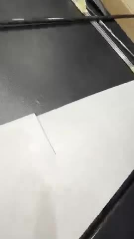](IMG_1453-2.mp4) | [Watch clip 20](IMG_1453-2.mp4) | 1:01 |
| **21 · Fuselage section** | [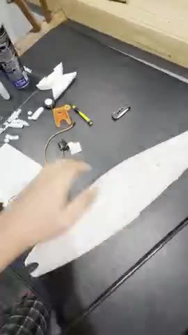](IMG_1453.mp4) | [Watch clip 21](IMG_1453.mp4) | 1:01 |

[Back to video dates](#videos)

Original filenames and viewing-copy details

| Clip | Original recording |
|---|---|
| 01 | IMG_1437.MOV |
| 02 | IMG_1438.MOV |
| 03 | IMG_1439.MOV |
| 04 | IMG_1441.MOV |
| 05 | IMG_1449.MOV |
| 06 | IMG_1450.MOV |
| 07 | IMG_1451.MOV |
| 08 | IMG_1452.MOV |
| 09 | IMG_1453 13.MOV |
| 10 | IMG_1453 12.MOV |
| 11 | IMG_1453 11.MOV |
| 12 | IMG_1453 10.MOV |
| 13 | IMG_1453 9.MOV |
| 14 | IMG_1453 8.MOV |
| 15 | IMG_1453 7.MOV |
| 16 | IMG_1453 6.MOV |
| 17 | IMG_1453 5.MOV |
| 18 | IMG_1453 4.MOV |
| 19 | IMG_1453 3.MOV |
| 20 | IMG_1453 2.MOV |
| 21 | IMG_1453.MOV |

All 21 clips retain their full duration. MP4 viewing copies have a maximum dimension of 480 pixels at 15 fps, with audio retained where present. The original MOV files remain unchanged locally. Dates use America/Chicago time. The numbered IMG_1453 files are retained as supplied, including clips with similar or overlapping footage. See the [media manifest](manifest.json) for capture metadata and fingerprints.

---

[Home](../../README.md) · [Build log](../../docs/build-log.md) · [Photos](photos.md) · **Videos** · [Parts & costs](../../docs/parts-and-costs.md) · [Receipts](../orders/README.md)
