# Clear — Screenshots

[All projects](../../README.md) · [Project home](README.md) · [Story](build-log.md) · [Features](features.md) · [Screenshots](photos.md) · [Desktop view](photos.md#website-version) · [Mobile view](photos.md#mobile-version) · [Results](results.md) · [Sources](sources.md) · [Portfolio](https://github.com/CodedWithCaffein/Michael-Polanczyk-Portfolio)

These views show Clear on a computer and on a phone. Both are versions of the website; the mobile views do not show a separate native iOS app.

All 12 images are stored in this repository. Select an image to open the full-size file.

Privacy-edited copies hide personal record content. The image editor also resized and slightly changed the appearance of edited copies, so they are visual references rather than exact pixel-for-pixel originals. The three otherwise unchanged mobile views have extra metadata removed. No live workspace link is included.

## Website Version

Desktop website views. These are privacy-edited copies.

### Summary

[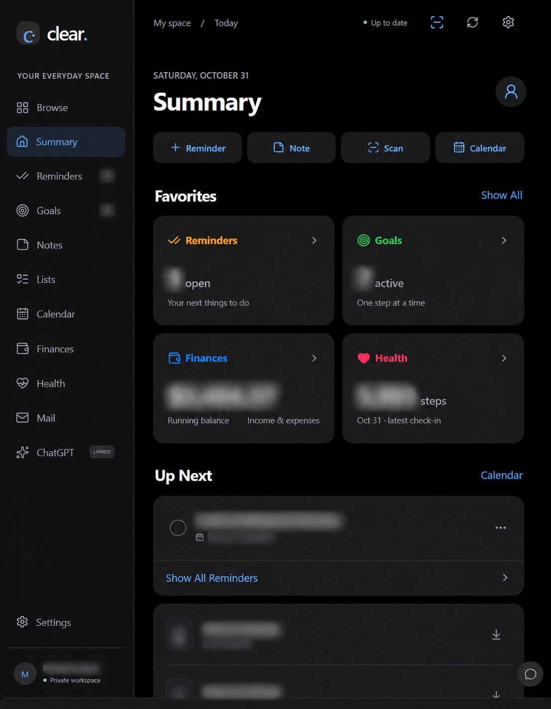](media/photos/website-summary.png)

### Health tracker

[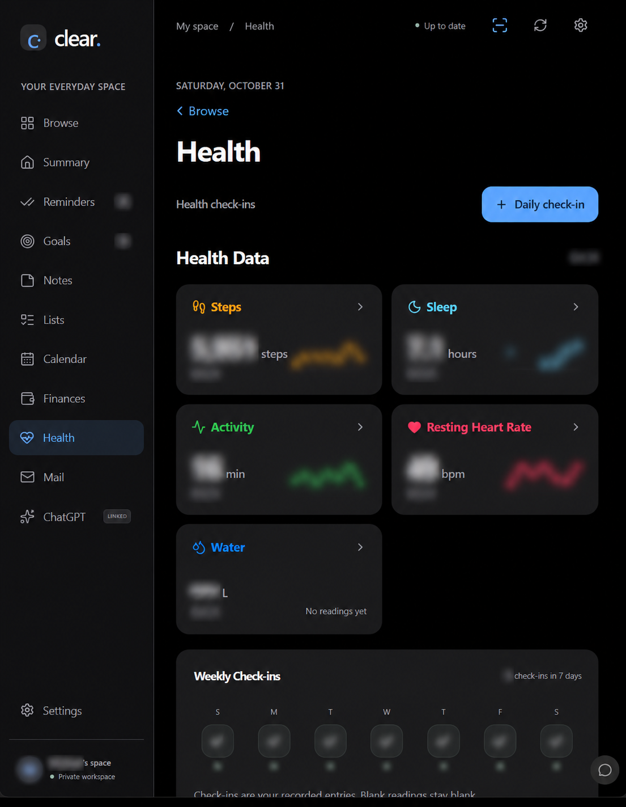](media/photos/website-health.png)

### Mail connections

[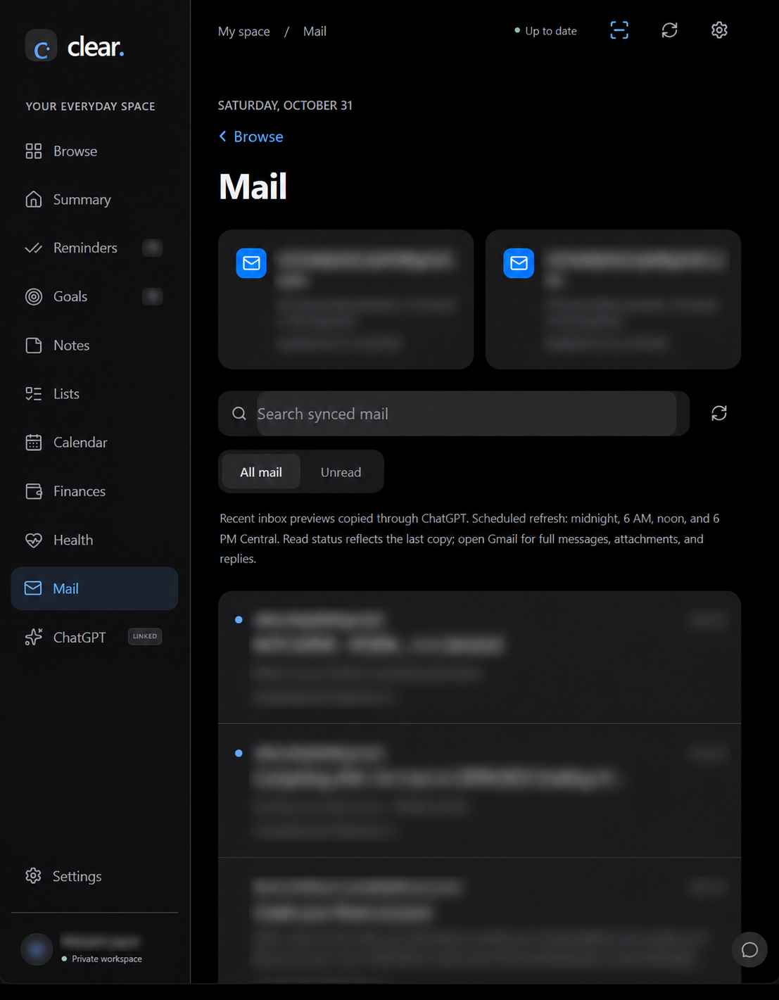](media/photos/website-mail.png)

### Finances

[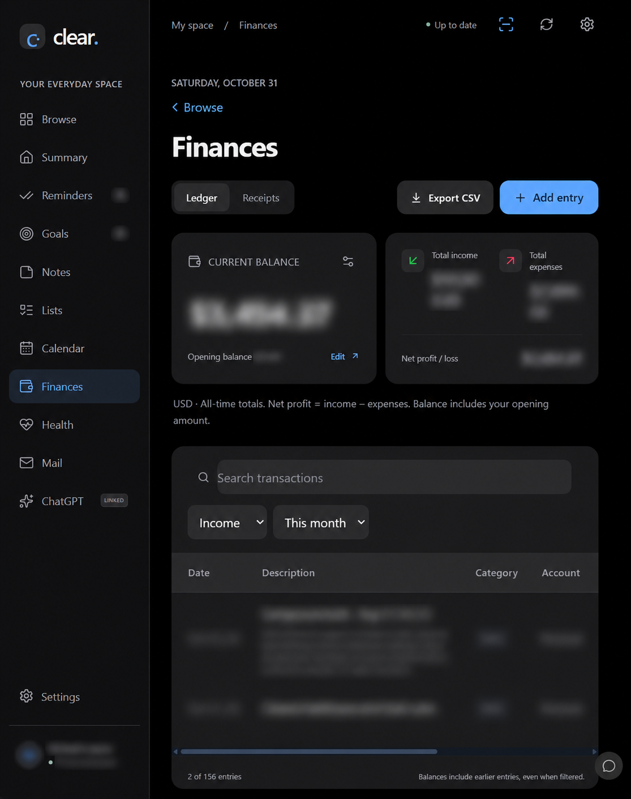](media/photos/website-finances.png)

### Browse

[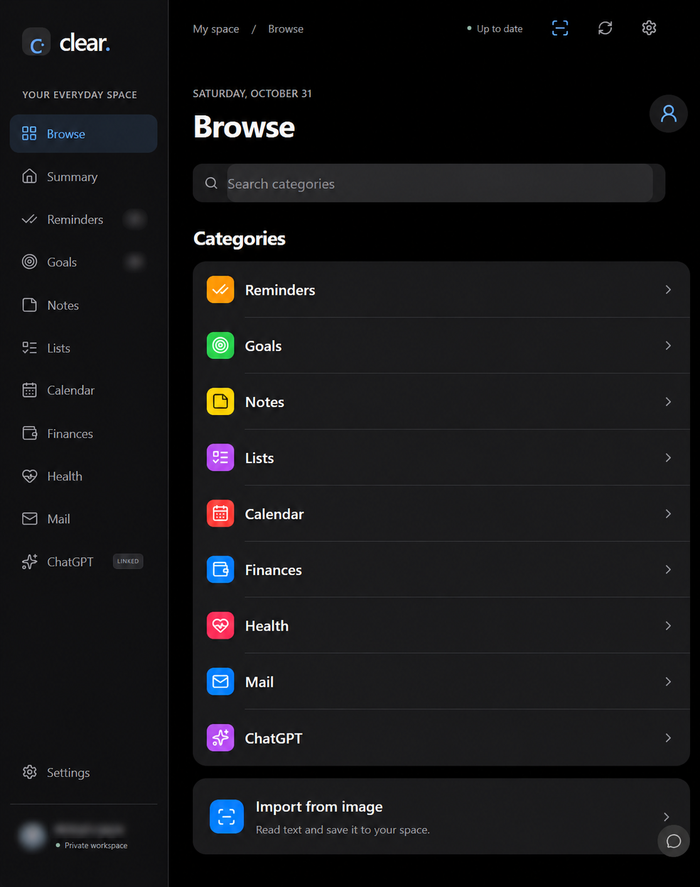](media/photos/website-browse.png)

### Calendar

[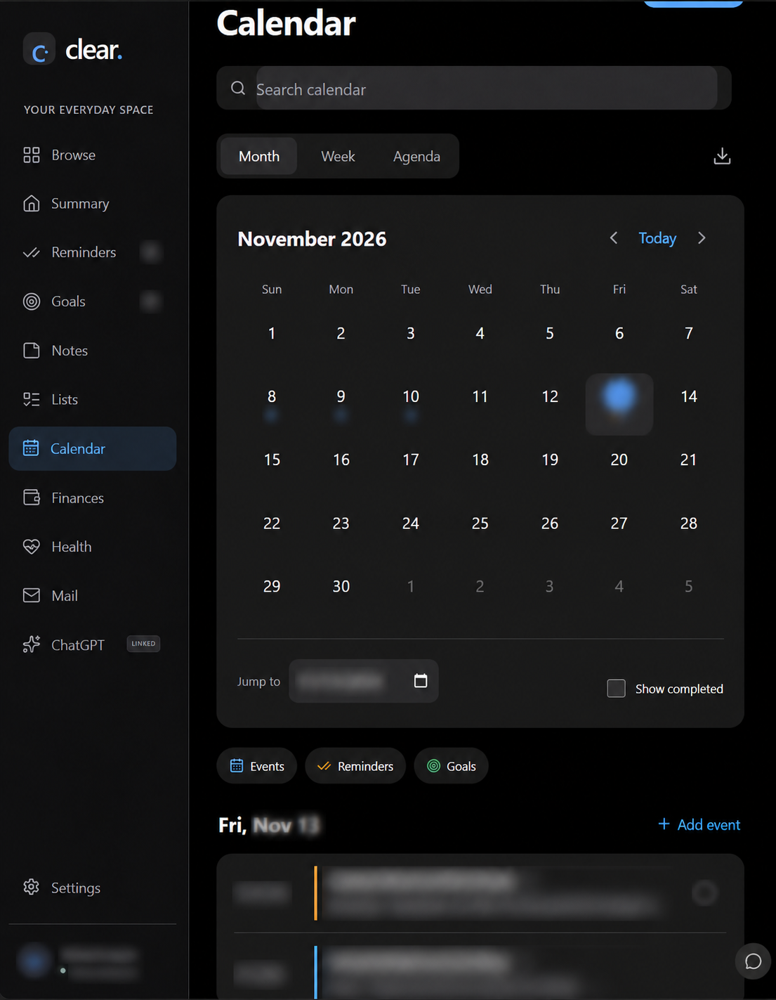](media/photos/website-calendar.png)

### Reminders

[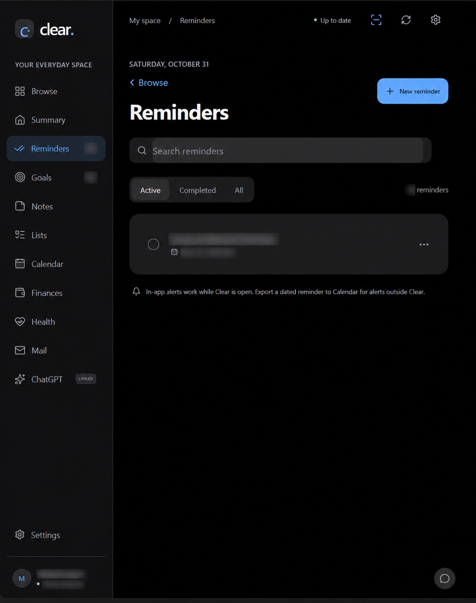](media/photos/website-reminders.png)

## Mobile Version

Mobile website views on an iPhone. Summary and Goals are privacy-edited. Scan & Import, Browse, and Assistant show the reviewed interface without private record content.

### Summary

[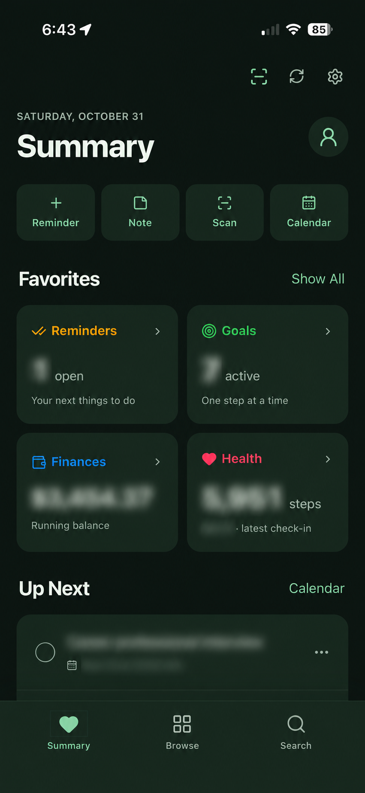](media/photos/mobile-summary.png)

### Goals

[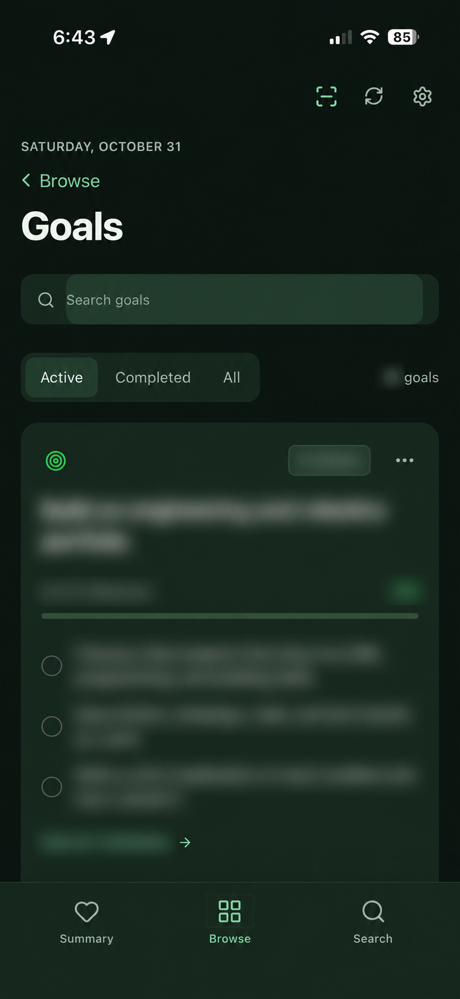](media/photos/mobile-goals.png)

### Scan & Import

[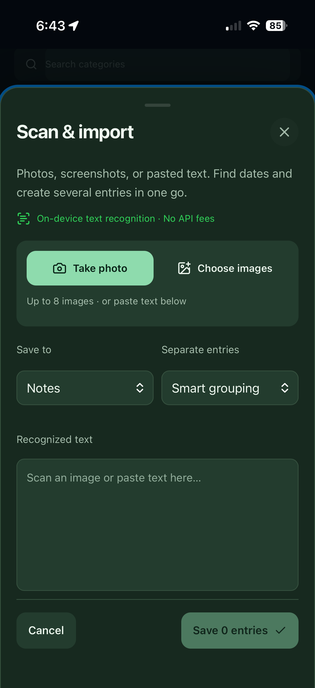](media/photos/mobile-scan-import.png)

### Browse

[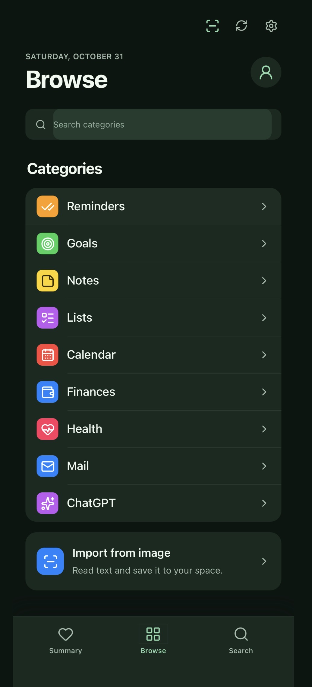](media/photos/mobile-browse.png)

### Assistant

[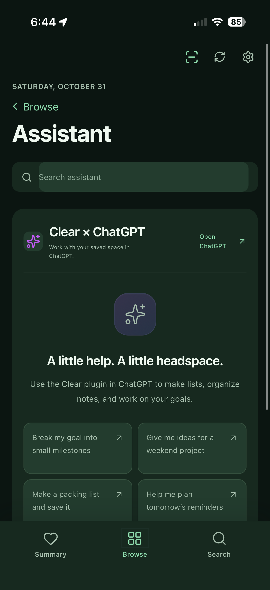](media/photos/mobile-assistant.png)

The supplied views were provided together on October 31, 2026. Upload dates are not treated as verified capture timestamps. These images document the interface, not a completed test of the features shown.
