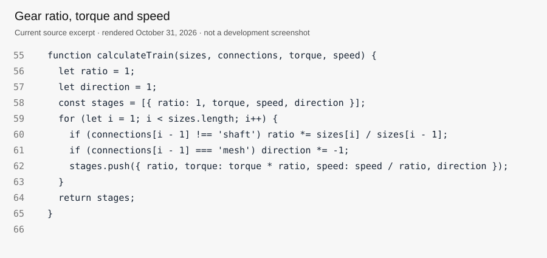
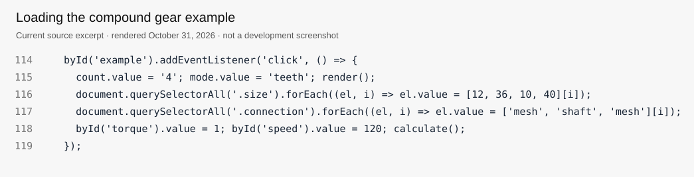

# Code images

[All projects](../../README.md) · [Project home](README.md) · [Story](build-log.md) · [Code images](photos.md) · [Results](results.md) · [Sources](sources.md) · [Portfolio](https://github.com/CodedWithCaffein/Michael-Polanczyk-Portfolio)

These images were rendered from the current source on October 31, 2026. They are code illustrations, not browser screenshots or earlier work-in-progress records. No historical development screenshots were supplied.

## Ratio calculation

The loop updates the ratio and direction, then records torque and speed for each gear.

## Loading an example

The example loads four gears with a shared middle shaft. Its total ratio is 12:1.

[Media inventory](media/README.md) · [Useful references](sources.md)
