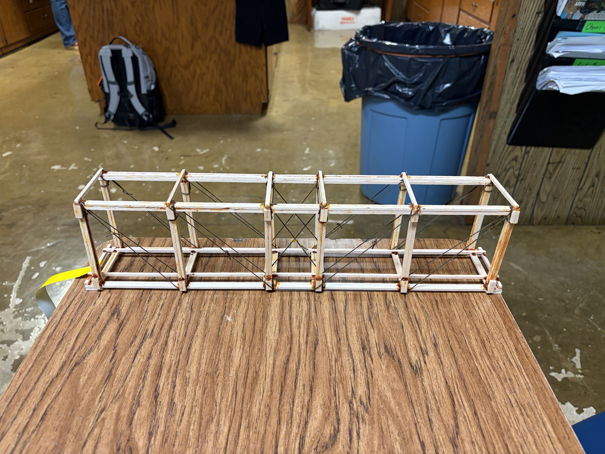

# MoDOT Bridge — 2026

[All projects](../../README.md) · [Project home](README.md) · [Story](build-log.md) · [Photos](photos.md) · [Videos](videos.md) · [Results](results.md) · [Sources](sources.md) · [Portfolio](https://github.com/CodedWithCaffein/Michael-Polanczyk-Portfolio)

My first MoDOT bridge competition: researching designs, drawing my own plans, and building a balsa bridge under time and material constraints.

## At a glance

| Field | Details |
| --- | --- |
| Status | Built · testing pending |
| Project updated | October 30, 2026 |
| Goal | Build a balsa bridge within the competition's material and design constraints. |
| My role | Final design, drawings, construction, and review of research and AI suggestions. |

## Project guide

| Section | What you'll find |
| --- | --- |
| [Story](build-log.md) | Background, decisions, progress, and lessons |
| [Photos](photos.md) | Project photos and reviewed viewing copies |
| [Videos](videos.md) | Clips and recordings, opened on request |
| [Results](results.md) | Checks, observations, and limits |
| [Sources](sources.md) | References and attribution |

*Full bridge view. Open the image to browse the construction gallery.*

## Progress

I explored several bridge layouts with ChatGPT, then drew my own final design on paper. With limited time and no extra supplied material for experiments, I chose a simpler design and emphasized a strong base. Construction took roughly four to four and a half days. I have not yet measured how well the bridge performs.

## Next steps

- [ ] Record final dimensions and bridge mass.
- [ ] Add the official inspection outcome and competition results.
- [ ] Document where failure begins and what I would change.
- [ ] Identify the final paper drawings and matching cleaned-up blueprints.

## Credits

I made the majority of the design and reviewed the suggestions myself. ChatGPT helped with research, some measurements, and clearer printable blueprints from my drawings. My estimate of around 30% assistance is a personal estimate, not a measured work breakdown. Earlier generated bridge proposals and optimizer estimates do not describe a verified final design or tested capacity.

---

[Media inventory](media/README.md) · [All projects](../../README.md) · [Personal portfolio](https://github.com/CodedWithCaffein/Michael-Polanczyk-Portfolio)
