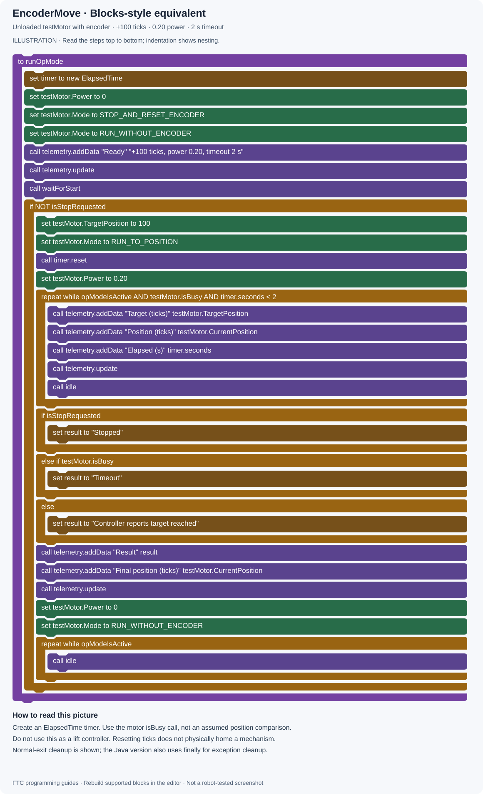

# 06 · Encoders and position control

[All projects](../../../README.md) · [Project home](README.md) · [Guides](guides.md) · [Examples](examples/README.md) · [Blocks pictures](blocks.md) · [Results](results.md) · [Sources](sources.md) · [Portfolio](https://github.com/CodedWithCaffein/Michael-Polanczyk-Portfolio)

**Question:** How do I move a motor to a repeatable target?

## Before you start

Use [EncoderMove.java](examples/EncoderMove.java), a motor named `testMotor`, and its connected encoder. This example moves an unloaded motor a small relative distance. It is not a finished lift controller.

## Step by step

1. Test encoder readings with MotorCheck first. Confirm a positive command produces the intended positive ticks.
2. Establish a physical reference when the mechanism needs absolute position. A homing switch or known startup position can provide that reference. Resetting an encoder only changes its number; it does not physically home anything.
3. In the unloaded demonstration, reset to zero and restore a running mode during initialization.
4. After PLAY, set a small target such as `100` ticks.
5. Set the mode to `RUN_TO_POSITION`, then set a positive power magnitude such as `0.20`. The target and current position determine direction.
6. Keep checking `opModeIsActive()`, `isBusy()`, and a timeout while displaying target and current ticks.
7. Set power to zero on completion, STOP, or timeout. Restore `RUN_WITHOUT_ENCODER` for later manual use.

## Convert real distances

For a wheel with no additional gearing:
`ticks = distance / (Math.PI × wheelDiameter) × ticksPerWheelRevolution`.

Use the same length unit for distance and diameter. If the encoder specification describes ticks per motor output revolution and there are two motor revolutions per wheel revolution, multiply by two. Check whether a vendor's published encoder number already includes its gearbox.

## Blocks-style picture

This illustration shows the equivalent control logic. Recreate it with FTC Blocks; expand the written expressions into Math and Logic blocks.

[Open full-size picture](media/drawings/encoder.svg) · [Blocks picture guide](blocks.md#encoder)

## Try it

Run +100 ticks, record the final reading, then change the target to -100 and repeat from the same reset reference. Small errors or overshoot are possible. Increase travel only after confirming signs and physical clearance.

## If it does not work

Never leave a stalled motor trying to reach an impossible target. A timeout is a fallback, not a substitute for limits. For a lift, add homing, upper/lower limits, controlled motion, and an appropriate gravity/holding strategy. Zero power can let a lift fall; test with mechanical support. Do not reset encoders every loop or while Pedro is using them for localization.

## Read next

[IMU](07-imu.md). Reference: [REV encoder modes](https://docs.revrobotics.com/duo-control/hello-robot-blocks/part-3/using-encoder).
