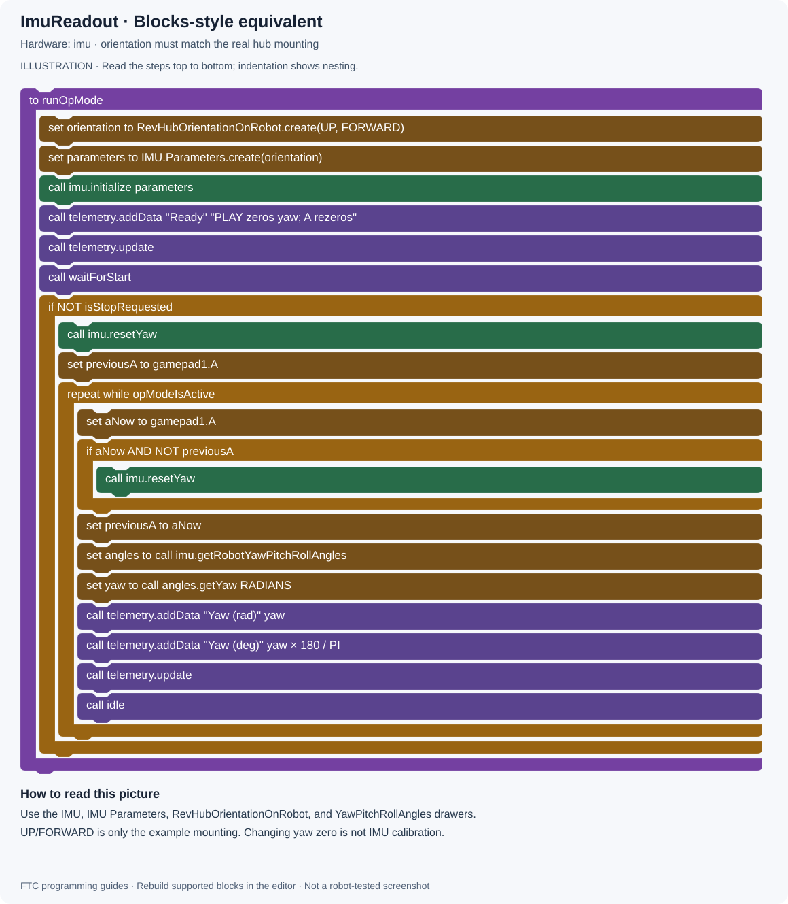
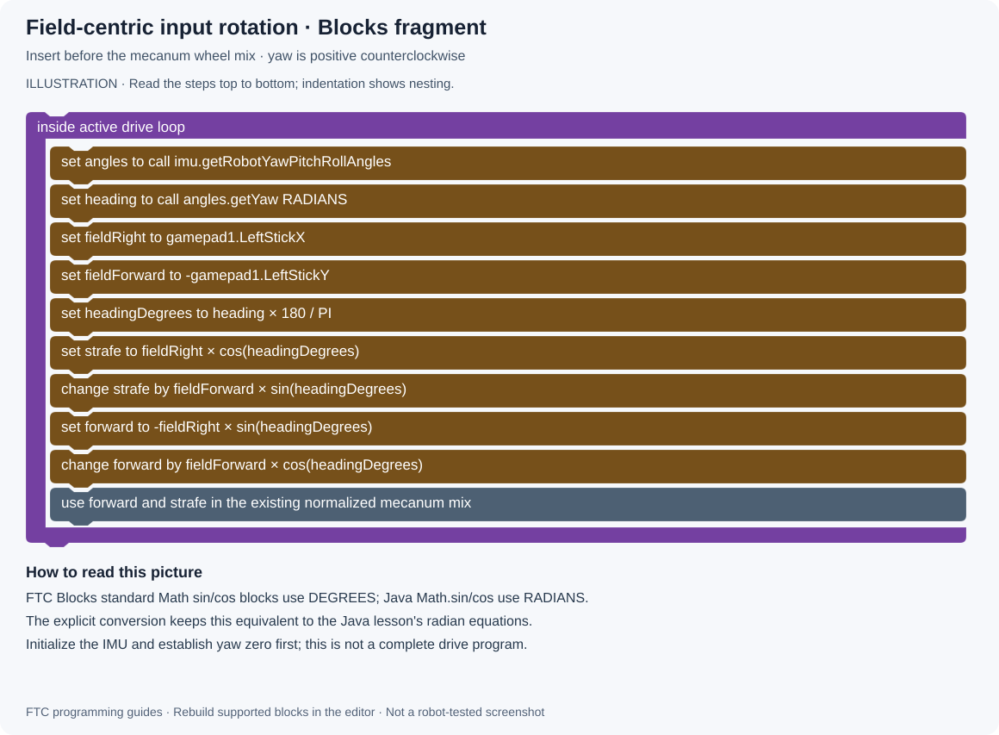

# 07 · IMU and Field-centric Driving

[All projects](../../../README.md) · [Project home](README.md) · [Guides](guides.md) · [Examples](examples/README.md) · [Blocks illustrations](blocks.md) · [Results](results.md) · [Sources](sources.md) · [Portfolio](https://github.com/CodedWithCaffein/Michael-Polanczyk-Portfolio)

**Question:** How do I use heading without mixing degrees and radians?

## Before you start

Use [ImuReadout.java](examples/ImuReadout.java) and an IMU configured as `imu`. The example assumes the Control Hub's REV logo faces up and its USB ports face robot forward. Change those settings to match your actual installation before running.

## Step by step

1. Map `IMU` from the hardware configuration.
2. Create `RevHubOrientationOnRobot` with the actual logo and USB directions.
3. Pass that orientation into `new IMU.Parameters(...)` and call `imu.initialize(...)`.
4. After PLAY, reset yaw while the robot is in a deliberately chosen reference orientation.
5. Read `imu.getRobotYawPitchRollAngles().getYaw(AngleUnit.RADIANS)` once per loop.
6. Display radians for the math and degrees for human checking.
7. Turn the robot roughly a quarter turn counterclockwise. The reading should change by about +90 degrees, allowing for the ±180-degree wrap.
8. Press A in the example to redefine the current yaw as zero. This is a reference change, not sensor calibration.

## Add field-centric translation

Once robot-centric mecanum works, rotate the field input into robot coordinates before using the existing wheel mix. For the mix in lesson 05, `strafe` is positive right and `forward` is positive forward. With yaw zero aligned to field forward:
```java
double heading = imu.getRobotYawPitchRollAngles()
        .getYaw(AngleUnit.RADIANS);
double fieldRight = gamepad1.left_stick_x;
double fieldForward = -gamepad1.left_stick_y;
double strafe = fieldRight * Math.cos(heading)
        + fieldForward * Math.sin(heading);
double forward = -fieldRight * Math.sin(heading)
        + fieldForward * Math.cos(heading);
```
This is an integration fragment, not a standalone OpMode. Add the IMU imports, initialization, and deliberate yaw reset from ImuReadout, then replace the translation input lines in MecanumTeleOp. Leave the turn input and normalization intact.


## Blocks-style picture

This illustration shows the equivalent control logic. Recreate it with FTC Blocks; expand the written expressions into Math and Logic blocks.



[Open full-size picture](media/drawings/imu.svg) · [Blocks picture guide](blocks.md#imu)

## Field-centric Blocks fragment

Standard FTC Blocks Math trigonometry uses degrees, while the Java fragment uses radians. The picture explicitly converts the IMU yaw before using the Blocks sin/cos blocks. Keep the remaining mecanum wheel mix unchanged.



[Open full-size picture](media/drawings/field-centric.svg)

## Try it

First check this mental case: at +90 degrees yaw, a field-forward request becomes robot-right strafe. Test slowly at zero and ±90 degrees. Start with readout only, then enable field-centric driving.

## If it does not work

Java trigonometry expects radians. Incorrect hub orientation can make yaw unreliable when the robot tilts. Resetting yaw during autonomous changes your reference unexpectedly. The IMU measures heading; it does not independently measure field X/Y position.

## Read next

[Autonomous sequences](08-autonomous.md). Reference: [FIRST universal IMU guide](https://ftc-docs.firstinspires.org/en/latest/programming_resources/imu/imu.html).
