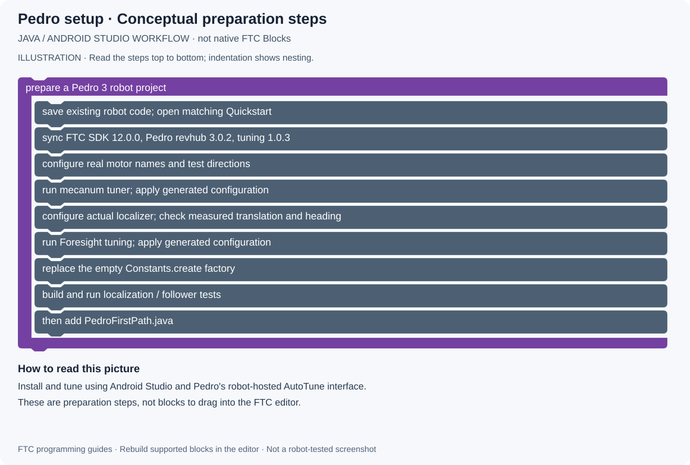

# 10 · Pedro Pathing installation and tuning

[All projects](../../../README.md) · [Project home](README.md) · [Guides](guides.md) · [Examples](examples/README.md) · [Blocks pictures](blocks.md) · [Results](results.md) · [Sources](sources.md) · [Portfolio](https://github.com/CodedWithCaffein/Michael-Polanczyk-Portfolio)

**Question:** How do I make Pedro match the real robot?

## Before you start

This guide targets **Pedro revhub 3.0.2**, **tuning 1.0.3**, and **FTC SDK 12.0.0**, matching the inspected Quickstart revision [4f33ef5](https://github.com/Pedro-Pathing/Quickstart/tree/4f33ef5bbbd99ebfe978f0b86046ca43469e2df2). It uses Android Studio. Do not combine this with Pedro 1.x/2.x imports or constants.

You need a functioning drivetrain and a supported, installed localization system, such as Pinpoint with odometry pods, OTOS, or supported wheel odometry. A path follower needs measured pose feedback; drawing a path is not enough.

## Step by step

1. Commit or back up existing robot code.
2. Open [Pedro Quickstart](https://github.com/Pedro-Pathing/Quickstart) as a separate Android Studio project. For the exact baseline, check out revision `4f33ef5bbbd99ebfe978f0b86046ca43469e2df2`. Preserve your existing robot project.
3. Sync Gradle and inspect `build.dependencies.gradle`. The baseline includes:
   ```groovy
   implementation 'com.pedropathing:revhub:3.0.2'
   implementation 'com.pedropathing:tuning:1.0.3'
   ```
   These use the Dairy releases Maven repository supplied in the Quickstart. If integrating into an existing project, follow [manual installation](https://pedropathing.com/docs/pathing/installation), add the repository and dependencies in the appropriate existing blocks, and bring over the matching `pedro` package and tuner procedures.
4. Configure the drivetrain's hardware names and check physical wheel directions.
5. Enable the mecanum tuner in `pedro/Tuning.java`. Use Android Studio to import the matching `Tuner`, `Procedure`, and `MecanumTuner` classes from this Quickstart:
   ```java
   @Tuner
   public static Procedure mecanumTuner() {
       return new MecanumTuner();
   }
   ```
   This is a method inside Tuning, not a complete file.
6. Deploy, connect the computer to the robot's network, and open `http://192.168.43.1:10158` for a Control Hub. Follow the mecanum procedure with wheels clear for direction checks. Apply its generated drivetrain configuration.
7. Follow the official tuning page for your actual localizer. Enter measured offsets, device names, encoder directions, and units. Test by moving and rotating the robot known distances; fix signs and scale before follower tuning.
8. Complete the Foresight tuning procedure on a clear field. Some procedures move or spin the robot automatically. Apply the generated settings and run the official tests.
9. Complete `Constants.create(hardwareMap)`. The baseline Quickstart initially returns `null`; it will not create a usable follower until you replace that stub.
10. Build your configured project successfully before adding the first path example.

## Connect the three parts

For a Pinpoint mecanum robot, the construction order verified in Pedro's source is:
```java
return new Follower(
    new PinpointLocalizer(h, localizerConfig),
    new Mecanum(h, drivetrainConfig),
    new Foresight(foresightConfig)
);
```
This fragment belongs inside `Constants.create(HardwareMap h)`. The three configuration variables must be real, tuned configurations, with the corresponding imports. Use the appropriate localizer and drivetrain for your hardware. Do not substitute made-up constants or copy another robot's offsets.


## Block-style logic picture

This is a conceptual diagram of the Java workflow, not native FTC Blocks.



[Open full-size picture](media/drawings/pedro-setup.svg) · [Blocks picture guide](blocks.md#pedro-setup)

## Try it

Run the localization test without a path. Check that position and heading follow measured physical motion. Then run the official follower tests before [your first path](11-pedro-auto.md).

## If it does not work

Unresolved `com.pedropathing` imports indicate dependency/sync issues. A null follower often means the Quickstart stub remains. Wrong measured motion means localizer configuration needs attention. Poor tracking after correct localization calls for drivetrain/follower tuning. Change one thing at a time.

References: [Installation](https://pedropathing.com/docs/pathing/installation), [Mecanum](https://pedropathing.com/docs/pathing/tuning/drivetrain/mecanum), [Localization](https://pedropathing.com/docs/pathing/tuning/localization), [Foresight](https://pedropathing.com/docs/pathing/tuning/foresight), [Constants](https://pedropathing.com/docs/pathing/tuning/constants).
