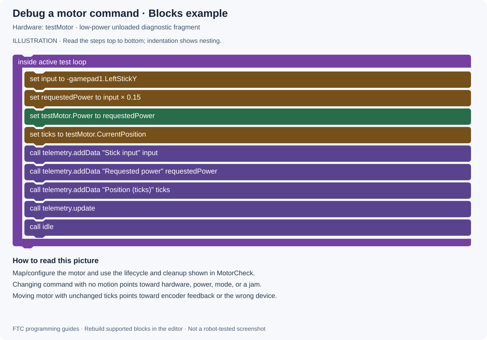

# 12 · Debugging and Match Preparation

[All projects](../../../README.md) · [Project home](README.md) · [Guides](guides.md) · [Examples](examples/README.md) · [Blocks illustrations](blocks.md) · [Results](results.md) · [Sources](sources.md) · [Portfolio](https://github.com/CodedWithCaffein/Michael-Polanczyk-Portfolio)

**Question:** How do I find a failure and check the fix?

## Before you start

Save the current code and reproduce the symptom with the smallest possible test. Describe the actual behavior, not just "it does not work."

## Step by step

1. Decide which stage fails: Gradle sync, Java compilation, installation, INIT, or running.
2. Read the first useful error message and its file/line. Later errors may be consequences.
3. Confirm the deployed OpMode name and selected hardware configuration.
4. Display the input, requested command, measured feedback, and current state.
5. Isolate one subsystem. Use MotorCheck before debugging a whole drivetrain and ImuReadout before debugging field-centric driving.
6. Change one thing, rerun the same test, and record what changed.
7. Test the original failing case again, plus STOP, restart, and an ordinary successful case.
8. Commit a confirmed working version with a message that names the fix.

## Symptom guide

| Symptom | Check first |
| --- | --- |
| Java cannot resolve a class | Spelling, import, dependency, and library version |
| OpMode absent from Driver Station | Deployment target, annotation, `@Disabled`, and successful build |
| Error during INIT | Hardware name/type and active configuration |
| Motor command changes but shaft does not | Power, cable, port, run mode, physical jam |
| Motor moves but encoder stays fixed | Encoder connection and correct feedback port |
| Servo chatters between states | Button edge logic and multiple writers |
| Robot drives the wrong direction | Physical motor identities, direction setup, wheel layout |
| Autonomous state never finishes | Transition condition, sensor feedback, timer reset location |
| Pedro moves correctly in one axis only | Localizer axis directions, scale, offsets, units |
| Pedro pauses while a mechanism moves | Blocking loop/sleep preventing `follower.update()` |

## Before a driver practice or match

1. Confirm the intended code version and robot configuration.
2. Check battery, connections, mechanism reference positions, and autonomous start placement.
3. Verify controls and emergency STOP behavior in a clear area.
4. Run the intended autonomous from the exact starting setup; one lucky run is not enough.
5. Keep a known working commit available. Avoid untested last-minute changes.

## Blocks-style picture

This illustration shows the equivalent control logic. Recreate it with FTC Blocks; expand the written expressions into Math and Logic blocks.

[Open full-size picture](media/drawings/debugging.svg) · [Blocks picture guide](blocks.md#debugging)

## Try it

Choose a harmless software fault, such as a misspelled telemetry label or wrong OpMode display name. Predict the effect, deploy, observe it, and restore the baseline. Use the same prediction/test habit for real faults.

## Record a useful test

Write the code revision, hardware configuration, starting conditions, expected behavior, measured outcome with units, and next change. Keep measured results separate from guesses. Do not label an autonomous reliable until repeated physical tests support that description.

## Read next

Return to [Guides](guides.md) or choose a file from [Examples](examples/README.md).
