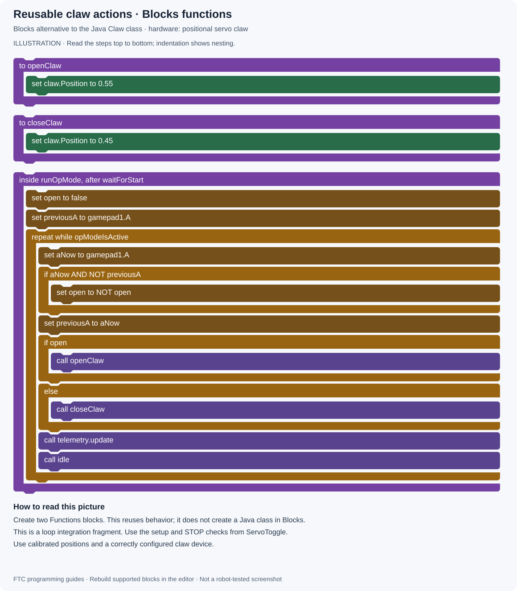

# FTC Programming — Blocks Illustrations

[All projects](../../../README.md) · [Project home](README.md) · [Guides](guides.md) · [Examples](examples/README.md) · [Blocks illustrations](blocks.md) · [Results](results.md) · [Sources](sources.md) · [Portfolio](https://github.com/CodedWithCaffein/Michael-Polanczyk-Portfolio)

Pictures for all eight standalone Java examples, plus the reusable-function, field-centric, setup, and debugging lessons.

## Read the pictures

These are original **Blocks-style illustrations**, not screenshots exported from the FTC editor, importable `.blk` files, or robot-tested programs. The labels describe operations; long expressions are kept together for readability. In the editor, construct their Math/Logic value blocks and use each configured device's actual blocks.

Read top to bottom. Indentation shows nesting. Purple marks functions/calls, gold marks control/variables, green marks hardware, and slate marks conceptual actions. An **else** attaches to the immediately preceding **if**; it is not a separate standalone block.

The motor diagrams show ordinary loop-exit cleanup. The Java examples also use `finally` to clean up if an exception occurs; the illustrations do not claim to reproduce Java exception handling.

For Pedro, use the Java source and setup guide. Its pictures explain the logic and do not provide a native FTC Blocks implementation.

## Find a picture

| Example or subject | Picture |
| --- | --- |
| TelemetryBasics | [View](#telemetry) |
| MotorCheck | [View](#motor-check) |
| ServoToggle | [View](#servo-toggle) |
| MecanumTeleOp | [View](#mecanum) |
| EncoderMove | [View](#encoder) |
| ImuReadout | [View](#imu) |
| SequenceDemo | [View](#sequence) |
| PedroFirstPath | [View](#pedro) |
| Reusable claw actions | [View](#functions) |
| Field-centric input rotation | [View](#field-centric) |
| Pedro setup | [View](#pedro-setup) |
| Debug a motor command | [View](#debugging) |

## TelemetryBasics

No hardware. ElapsedTime timer, start/stop lifecycle, and live Driver Station values. Decimal formatting and the Java telemetry transmission-interval customization are omitted.

[Open full-size picture](media/drawings/telemetry.svg)

## MotorCheck

A/B momentary motor commands, encoder display, and normal-exit zero power.

[Open full-size picture](media/drawings/motor-check.svg)

## ServoToggle

Button-edge detection, persistent toggle state, and conservative servo positions.

[Open full-size picture](media/drawings/servo-toggle.svg)

## MecanumTeleOp

Forward/strafe/turn mixing with normalization. Grouped device operations must be expanded into one block per motor.

[Open full-size picture](media/drawings/mecanum.svg)

## EncoderMove

Relative encoder target, RUN_TO_POSITION, an active/busy/timeout guard, and normal-exit cleanup.

[Open full-size picture](media/drawings/encoder.svg)

## ImuReadout

Mounting parameters, yaw reset on a button edge, and angle readout.

[Open full-size picture](media/drawings/imu.svg)

## SequenceDemo

A display-only state machine. Text states and an if/else-if chain replace the Java enum and switch.

[Open full-size picture](media/drawings/sequence.svg)

## PedroFirstPath

Conceptual execution order for the Pedro Java example. No native Pedro blocks or custom wrappers are supplied.

[Open full-size picture](media/drawings/pedro.svg)

## Reusable claw actions

Two reusable Blocks Functions give the open/close behavior of the Java Claw class. The caller is a loop fragment.

[Open full-size picture](media/drawings/functions.svg)

## Field-centric input rotation

A drive-loop fragment that converts radians to degrees before using Blocks trigonometry.

[Open full-size picture](media/drawings/field-centric.svg)

## Pedro setup

A conceptual setup workflow for Android Studio, robot configuration, and Pedro tuning.

[Open full-size picture](media/drawings/pedro-setup.svg)

## Debug a motor command

A small diagnostic-loop fragment showing input, requested motor power, and measured encoder feedback.

[Open full-size picture](media/drawings/debugging.svg)
