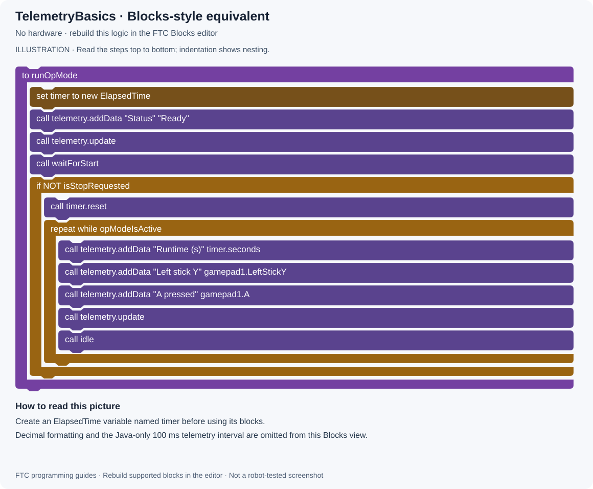
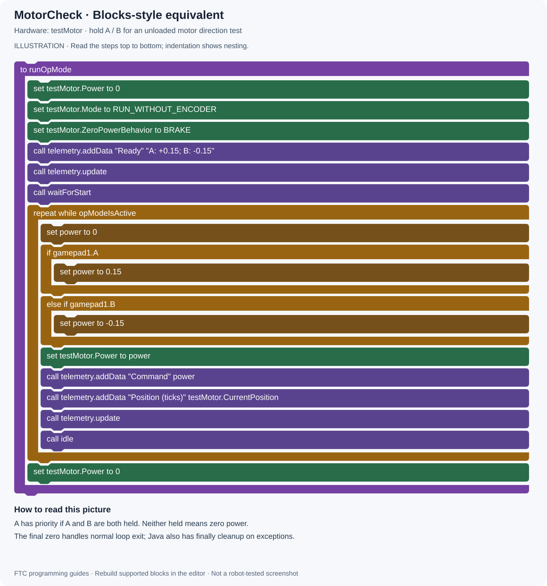
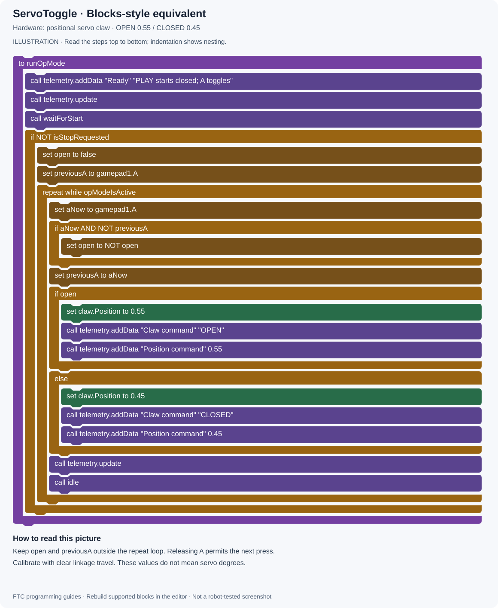
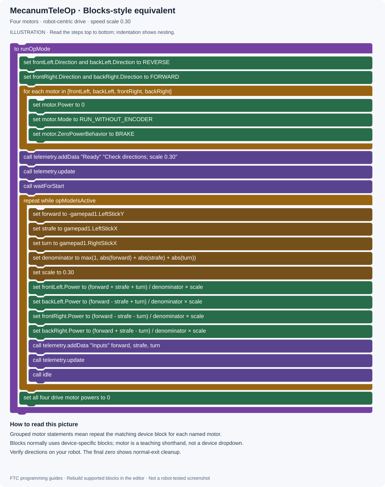
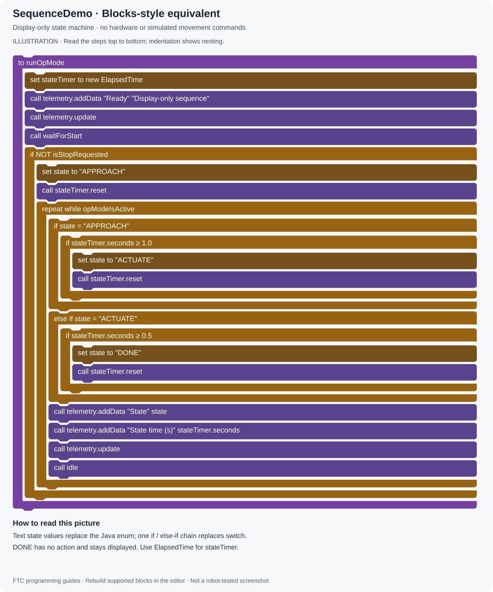

# FTC Java examples

[All projects](../../../../README.md) · [Project home](../README.md) · [Guides](../guides.md) · [Examples](README.md) · [Blocks pictures](../blocks.md) · [Results](../results.md) · [Sources](../sources.md) · [Portfolio](https://github.com/CodedWithCaffein/Michael-Polanczyk-Portfolio)

These are complete teaching OpModes, not a standalone robot application. Copy the selected file into `TeamCode/src/main/java/org/firstinspires/ftc/teamcode/` in your FTC Android Studio project. Keep the package line, imports, filename, and public class name together. Deploy from Android Studio, then select the listed OpMode on the Driver Station.

| File | Driver Station name | Hardware / dependencies | Guide |
| --- | --- | --- | --- |
| [TelemetryBasics.java](TelemetryBasics.java) | Guide - Telemetry | FTC SDK only; no hardware | [Telemetry](../02-telemetry.md) |
| [MotorCheck.java](MotorCheck.java) | Guide - Motor Check | Motor named `testMotor` | [Hardware](../03-hardware.md) |
| [ServoToggle.java](ServoToggle.java) | Guide - Servo Toggle | Positional servo named `claw` | [Controls](../04-controls.md) |
| [MecanumTeleOp.java](MecanumTeleOp.java) | Guide - Mecanum | Four motors: `frontLeft`, `backLeft`, `frontRight`, `backRight` | [Mecanum](../05-mecanum.md) |
| [EncoderMove.java](EncoderMove.java) | Guide - Encoder Move | Unloaded motor named `testMotor`, with encoder | [Encoders](../06-encoders.md) |
| [ImuReadout.java](ImuReadout.java) | Guide - IMU | IMU named `imu`; edit mounting orientation | [IMU](../07-imu.md) |
| [SequenceDemo.java](SequenceDemo.java) | Guide - Sequence | FTC SDK only; no hardware | [Autonomous](../08-autonomous.md) |
| [PedroFirstPath.java](PedroFirstPath.java) | Guide - Pedro First Path | Pedro revhub 3.0.2, tuned drivetrain/localizer/Foresight and `pedro.Constants` | [Pedro autonomous](../11-pedro-auto.md) |

## Before running

Read the linked guide first. Verify configuration names, directions, and mechanical travel. Initial drive tests use wheels clear; servo tests need checked linkage clearance. EncoderMove is for an unloaded motor, not a gravity-loaded mechanism. PedroFirstPath uses tuned motion constraints and can move immediately after PLAY.

For an SDK-only project, copy only SDK examples. Adding PedroFirstPath without its dependencies will prevent the project from compiling.

## Adapt an example

1. Make a working backup of the robot project.
2. Copy one file and build.
3. Edit only its hardware names and required configuration.
4. Run the lesson's expected-result check.
5. Add one feature at a time, with telemetry showing its input and output.

Examples have not been compiled or robot-tested in this session. See [Results](../results.md).

## Blocks-style pictures

Open a picture below to compare the example's logic with its Java file. These are teaching illustrations; see [Blocks pictures](../blocks.md) for the notation and differences from native editor blocks.

TelemetryBasics — Blocks-style view

[Java source](TelemetryBasics.java) · [Explanation](../blocks.md#telemetry)

[Open full-size picture](../media/drawings/telemetry.svg)

MotorCheck — Blocks-style view

[Java source](MotorCheck.java) · [Explanation](../blocks.md#motor-check)

[Open full-size picture](../media/drawings/motor-check.svg)

ServoToggle — Blocks-style view

[Java source](ServoToggle.java) · [Explanation](../blocks.md#servo-toggle)

[Open full-size picture](../media/drawings/servo-toggle.svg)

MecanumTeleOp — Blocks-style view

[Java source](MecanumTeleOp.java) · [Explanation](../blocks.md#mecanum)

[Open full-size picture](../media/drawings/mecanum.svg)

EncoderMove — Blocks-style view

[Java source](EncoderMove.java) · [Explanation](../blocks.md#encoder)

[Open full-size picture](../media/drawings/encoder.svg)

ImuReadout — Blocks-style view

[Java source](ImuReadout.java) · [Explanation](../blocks.md#imu)

[Open full-size picture](../media/drawings/imu.svg)

SequenceDemo — Blocks-style view

[Java source](SequenceDemo.java) · [Explanation](../blocks.md#sequence)

[Open full-size picture](../media/drawings/sequence.svg)

PedroFirstPath — conceptual Java workflow

[Java source](PedroFirstPath.java) · [Explanation](../blocks.md#pedro)

[Open full-size picture](../media/drawings/pedro.svg)

