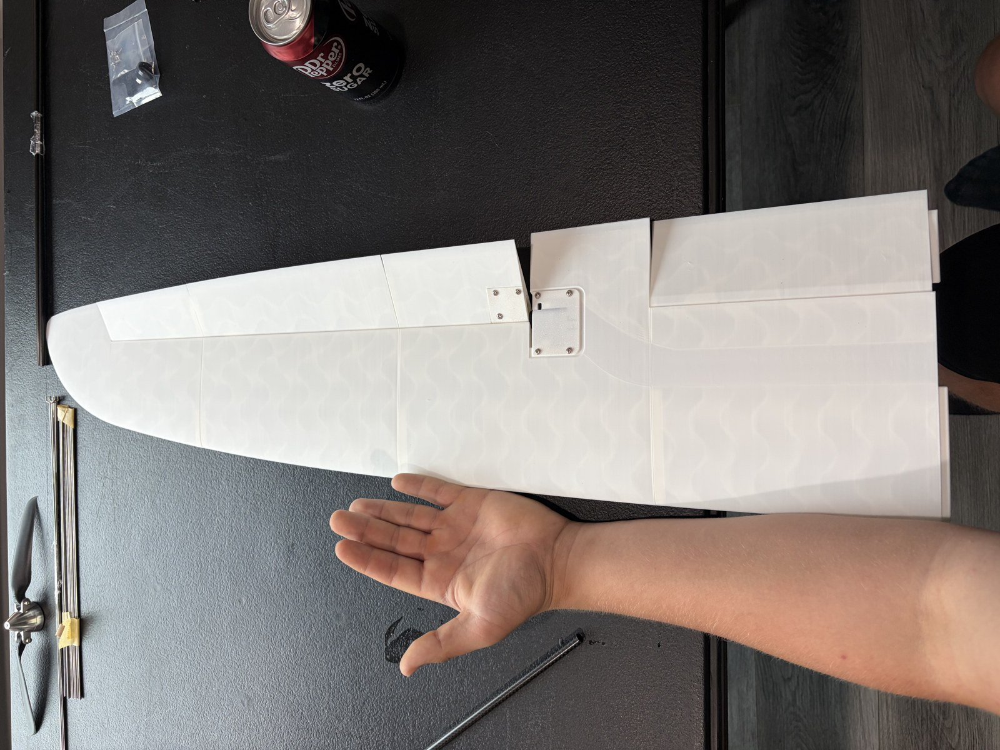

# Eclipson Vortex RC Airplane

[All projects](../../README.md) · [Project home](README.md) · [Story](build-log.md) · [Parts & costs](parts-and-costs.md) · [Photos](photos.md) · [Videos](videos.md) · [Receipts](receipts.md) · [Portfolio](https://github.com/CodedWithCaffein/Michael-Polanczyk-Portfolio)

My 3D-printed RC airplane build, from printed parts to assembly, electronics setup, and eventual flight testing.

## At a glance

| Field | Details |
| --- | --- |
| Status | Paused · target: end of summer 2027 |
| Project updated | October 30, 2026 |
| Goal | Finish the build, complete ground checks, and prepare for flight testing. |
| My role | Component research, printing, assembly, and integration; aircraft design by Eclipson. |

## Project guide

| Section | What you'll find |
| --- | --- |
| [Story](build-log.md) | Aircraft selection, printing, assembly, and build setbacks |
| [Parts & costs](parts-and-costs.md) | Airframe materials, electronics, purchases, and cost limits |
| [Photos](photos.md) | Printing and assembly, with capture dates where known |
| [Videos](videos.md) | Printing and assembly clips with click-to-open links |
| [Receipts](receipts.md) | Redacted purchase records |

*Wing assembly, May 26, 2026. Select the image to open Photos.*

## Background

I chose the Eclipson Vortex as my first airplane build after researching the cost and practical limits of designing one from scratch. The project lets me work on printing, assembly, and electronics before taking on a full aircraft design.

## Progress

I have printed airframe and wing sections and purchased the main electronics and control hardware. The April 22–May 29 progress update is documented by photos and videos captured on May 22, 26, and 27.

A stolen carbon-fiber shipment and the change from an ER6 to an ER8 receiver added delays and cost. Final assembly, electronics installation, ground checks, and flight testing are still ahead.

## Next steps

- [ ] Inventory stored parts and replace any missing reinforcement.
- [ ] Complete airframe assembly and electronics installation.
- [ ] Configure controls and complete balance, range, and ground checks.
- [ ] Carry out the first flight and record the results.

## Credits

The aircraft design and supplied CAD/printing files are by [Eclipson](https://www.eclipson-airplanes.com/). My work is researching, printing, selecting and integrating components, assembling, and documenting this build.

---

[Media inventory](media/README.md) · [All projects](../../README.md) · [Personal portfolio](https://github.com/CodedWithCaffein/Michael-Polanczyk-Portfolio)
